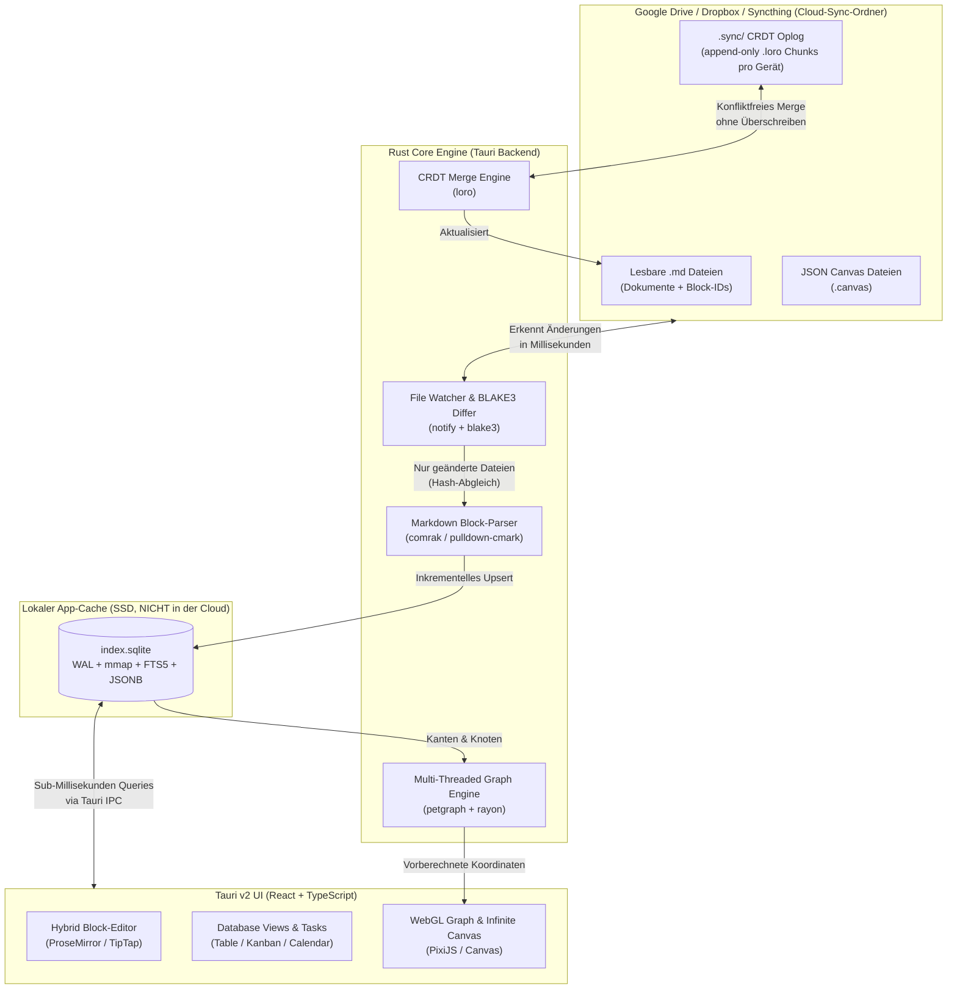
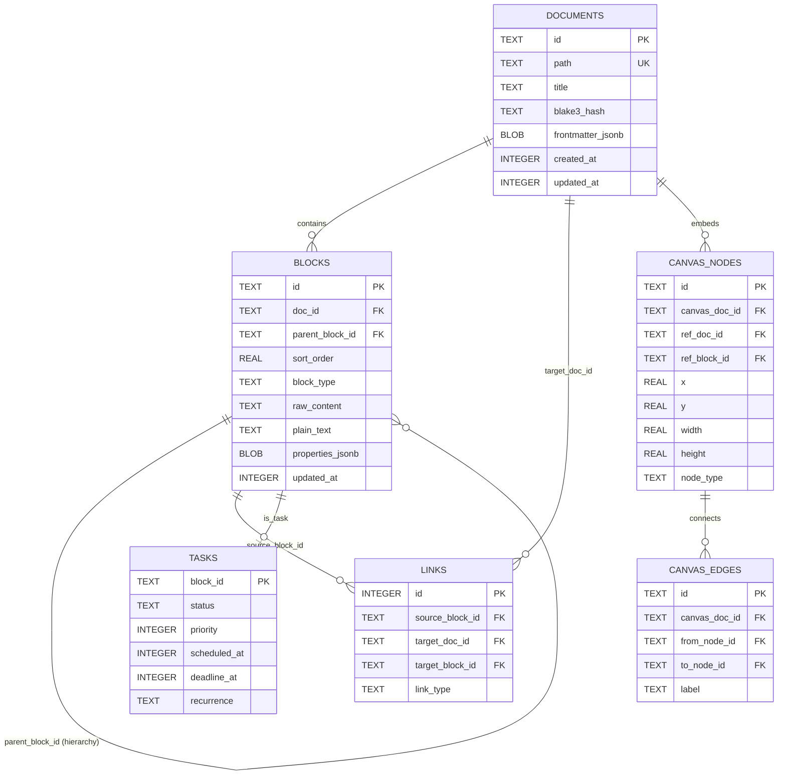

# Architektur- & Konzept-Spezifikation: Rust Knowledge Graph & Hybrid Note-Taking App

> [!IMPORTANT]
> **Leitprinzip:** Maximale Geschwindigkeit & minimaler RAM-Verbrauch durch einen nativen **Rust-Core** (auch bei 100.000+ Blöcken/Notizen), kombiniert mit **100 % Cloud-Sync-Sicherheit** (Google Drive, Dropbox, OneDrive, iCloud) und der **Flexibilität eines Hybrid-Editors** (freie Dokumente wie Obsidian + adressierbare Blöcke wie Logseq).

---

## 1. Vision & Kernziele

Klassische Notiz-Tools wie Obsidian und Logseq stoßen bei großen Wissensgraphen an strukturelle Grenzen:
- **Electron/JavaScript-Overhead:** Hoher RAM-Verbrauch (oft 1–2 GB im Idle), spürbare Startzeiten und Single-Threaded-UI-Ruckler bei Graph-Berechnungen oder großen Queries.
- **Ungecachtes Markdown-Parsing:** Wenn tausende `.md`-Dateien beim App-Start komplett geparst werden müssen, skaliert das System linear schlecht mit der Vault-Größe.
- **Cloud-Sync-Konflikte:** Binäre Datenbank-Dateien direkt in Google Drive oder gleichzeitige Edits auf zwei Geräten führen zu Konfliktkopien oder korrupten Dateien.

**Unsere Lösung:**
1. **Rust-Core + Tauri v2 + React/TypeScript:** Alle rechenintensiven Aufgaben (Dateisystem-Überwachung, Hashing, Markdown-Parsing, Volltext-Index, Graph-Layouts, CRDT-Merges) laufen nativ und multi-threaded in Rust. Die UI bleibt eine schlanke, reaktive Webview-Oberfläche ohne Electron-Ballast.
2. **Hybrid-Notizmodell:** Du schreibst freie Langform-Dokumente wie in Obsidian, aber **jeder Absatz und jedes Listenelement ist intern ein eigenständig adressierbarer Block** mit eigener UUID, eigenen Properties, Backlinks und Query-Fähigkeit wie in Logseq.
3. **Dual-Layer Storage:** Strikte Trennung zwischen **Cloud-sicherer Persistenz** (im Google Drive) und **lokalem Hochgeschwindigkeits-Index** (außerhalb der Cloud auf der lokalen SSD).

---

## 2. Datenbank-Entscheidung: SQLite vs. MariaDB vs. Rust-Embedded-DBs

Eine zentrale Architekturentscheidung ist die Wahl der lokalen Index- und Query-Engine. Warum **SQLite** (statt eines Server-DBMS wie **MariaDB**) für eine lokale Desktop-App die überlegene Wahl ist:

### In-Process (Embedded) vs. Client-Server (MariaDB/PostgreSQL)

| Kriterium | SQLite (Embedded in Rust) | MariaDB (Client-Server-Daemon) | CozoDB / Redb + Tantivy (Pure Rust) |
| :--- | :--- | :--- | :--- |
| **Prozess-Modell** | Läuft **direkt im selben Prozess** als Rust-Bibliothek (`rusqlite`) | Benötigt separaten Hintergrund-Daemon (`mariadbd`) | Läuft direkt im selben Prozess |
| **Query-Latenz** | **~0,005 ms** (direkter Speicher-/Funktionsaufruf) | **~0,2–1,0 ms** (TCP/Unix-Socket + IPC + Serialisierung) | **~0,005–0,02 ms** |
| **200 Block-/Graph-Queries pro Seitenaufbau** | **~1 ms gesamt** (unverzögert, 60+ FPS) | **~40–200 ms** (spürbarer Lag beim Blättern) | **~1–4 ms gesamt** |
| **RAM-Overhead (Idle)** | **< 5 MB** (nur konfigurierter Page-Cache / `mmap`) | **150–400 MB** allein für den Server-Daemon | **< 10 MB** |
| **Nutzer-Setup** | **Zero-Config** (eine eingebettete Library, kein Port, kein Passwort) | Installations-, Service-, Port- & Rechte-Management | Zero-Config |
| **Volltextsuche** | Integriert via **FTS5** (BM25-Ranking in Millisekunden) | `FULLTEXT`-Index vorhanden, aber schwergewichtiger | Exzellent via **Tantivy** (Lucene in Rust) |
| **Graph- & Property-Queries** | `Recursive CTEs` + `JSONB`-Indizes + generierte Spalten | `Recursive CTEs` + JSON (langsamer bei vielen Kleinst-Lookups) | **Datalog** (nativ für Graph-Traversierungen) |

### Wann würde MariaDB überhaupt Sinn machen?
MariaDB/PostgreSQL wären nur dann sinnvoll, wenn **mehrere Nutzer gleichzeitig über ein Netzwerk auf einen zentralen Remote-Server** zugreifen würden (SaaS/Team-Backend). Für eine **Local-First-Desktop-App**, bei der die Daten im lokalen Dateisystem bzw. Google Drive liegen, ist das Client-Server-Modell ein reiner Flaschenhals.

> [!TIP]
> **Empfohlener Standard + Optionale Ausbaustufe:**
> Wir starten mit **SQLite (im WAL-Modus + `mmap` + `FTS5` + `JSONB`)** über `rusqlite` (`bundled`). SQLite meistert Millionen von Blöcken mühelos im einstelligen Millisekundenbereich. Falls bei extremen Graph-Traversierungen (z. B. 5+ Hops Datalog-Queries) oder >1 Mio. Blöcken noch mehr spezialisierte Leistung gebraucht wird, hält unser Trait-basiertes Rust-Backend (`IndexEngine` Trait) die Tür offen für **CozoDB** (Datalog-Graph-Engine) oder **Tantivy** (dedizierte Volltext-Engine).

---

## 3. Die Dual-Layer Storage- & Sync-Architektur

Warum darf eine SQLite-Datenbank **niemals direkt im Google-Drive-Ordner** liegen?
1. **Sync-Overhead:** Bei jedem getippten Wort ändert sich eine binäre SQLite-Datei – Google Drive müsste ständig Megabytes neu hochladen.
2. **Korruptions- & Konfliktgefahr:** Wenn Gerät A und Gerät B kurz offline editieren, kann Google Drive binäre SQLite-Seiten nicht zusammenführen. Das Resultat wären `index (Konfliktkopie).sqlite` oder beschädigte B-Trees.

Deshalb trennen wir strikt zwischen dem **Cloud-Vault (Source of Truth)** und dem **lokalen Turbo-Index**:



### Schicht 1: Der Vault im Google Drive (Source of Truth, 100 % konfliktfrei)
- **Lesbare `.md`-Dateien:** Alle Notizen bleiben Standard-Markdown. Du bist niemals in einem proprietären Binärformat eingesperrt und kannst Dateien notfalls mit jedem Texteditor lesen oder mit Git/Grep durchsuchen.
- **Block-Repräsentation in Markdown:**
  - Jeder Absatz, jede Überschrift, jeder Listenpunkt und jeder Code-Block bildet intern einen Block.
  - Um Blöcke über Gerätenamen, Dateiumbenennungen und Verschiebungen hinweg stabil referenzierbar zu halten (`((block-id))`), nutzt das System dezente Block-Marker (z. B. `^a1b2c3d4` am Zeilenende wie in Obsidian oder ein unsichtbarer HTML-Kommentar `<!-- id: 0193... -->`), idealerweise **lazy** oder kompakt via Base62-UUIDv7, ergänzt durch das Sidecar-CRDT-Mapping.
- **`.sync/` Ordner (CRDT-Oplog mit `loro`):**
  - Jedes Gerät schreibt Änderungen als kleine, unveränderliche (`append-only`) Snapshot- und Delta-Dateien: `.sync/<device_id>_<seq>.loro`.
  - **Null Konflikt-Risiko in Google Drive:** Da bestehende `.loro`-Dateien niemals von einem anderen Gerät überschrieben werden, erzeugt Google Drive **keine** Konfliktkopien mehr. Selbst bei gleichzeitiger Offline-Bearbeitung auf PC und Laptop führt `loro` beim nächsten Sync beide Änderungsstränge mathematisch sauber und deterministisch zusammen und schreibt das gemergte Ergebnis sauber zurück in die `.md`-Datei.

### Schicht 2: Der lokale SQLite-Turbo-Index (außerhalb von Google Drive)
- Liegt im lokalen System-Cache (z. B. `~/.local/share/<app-name>/vaults/<vault-id>/index.sqlite`).
- **Inkrementelle Aktualisierung:** Beim Start berechnet Rust per `blake3` (extrem schneller kryptographischer Hash, oft > 3 GB/s auf modernen CPUs) parallel über alle CPU-Kerne (`rayon`) die Hashes der `.md`-Dateien und parst ausschließlich Dateien, die sich seit dem letzten Scan geändert haben. Zur Laufzeit reagiert `notify` direkt auf File-Events.
- **100 % Ephemer & Reproduzierbar:** Geht der lokale Cache verloren oder wird gelöscht, baut Rust die gesamte `index.sqlite` in wenigen Sekunden vollständig aus dem Google-Drive-Ordner neu auf.

---

## 4. Konkretes Datenmodell & SQLite-Schema (Entwurf)



### Entwurf der SQLite-Tabellen & Performance-Pragmas

```sql
-- Verbindungs-Pragmas für maximale Desktop-Performance
PRAGMA journal_mode = WAL;
PRAGMA synchronous = NORMAL;
PRAGMA temp_store = MEMORY;
PRAGMA mmap_size = 268435456; -- 256 MB Memory-Mapped I/O
PRAGMA foreign_keys = ON;

CREATE TABLE documents (
    id TEXT PRIMARY KEY,              -- UUIDv7
    path TEXT NOT NULL UNIQUE,        -- Relativer Pfad im Vault
    title TEXT NOT NULL,
    blake3_hash BLOB NOT NULL,        -- 32-Byte BLAKE3 Hash für Delta-Sync
    frontmatter_jsonb BLOB,           -- SQLite JSONB für Dokument-Properties
    created_at INTEGER NOT NULL,
    updated_at INTEGER NOT NULL
);

CREATE TABLE blocks (
    id TEXT PRIMARY KEY,              -- Stabile Block-UUID (z.B. UUIDv7 / NanoID)
    doc_id TEXT NOT NULL REFERENCES documents(id) ON DELETE CASCADE,
    parent_block_id TEXT REFERENCES blocks(id) ON DELETE CASCADE,
    sort_order REAL NOT NULL,         -- Fractional Indexing für O(1) Drag & Drop
    block_type TEXT NOT NULL,         -- 'paragraph', 'heading', 'list_item', 'code', 'quote', 'callout'
    raw_content TEXT NOT NULL,        -- Original Markdown des Blocks
    plain_text TEXT NOT NULL,         -- Bereinigter Text für Suche & Previews
    properties_jsonb BLOB,            -- Block-Level Properties (z.B. status, author, rating)
    updated_at INTEGER NOT NULL
);

CREATE INDEX idx_blocks_doc_sort ON blocks(doc_id, sort_order);
CREATE INDEX idx_blocks_parent ON blocks(parent_block_id);

CREATE TABLE links (
    id INTEGER PRIMARY KEY AUTOINCREMENT,
    source_block_id TEXT NOT NULL REFERENCES blocks(id) ON DELETE CASCADE,
    target_doc_id TEXT REFERENCES documents(id) ON DELETE SET NULL,
    target_block_id TEXT REFERENCES blocks(id) ON DELETE SET NULL,
    target_raw TEXT NOT NULL,         -- Unaufgelöster Name für "Unresolved / Ghost Links"
    link_type TEXT NOT NULL           -- 'wiki_link' | 'block_ref' | 'embed' | 'tag' | 'property_rel'
);

CREATE INDEX idx_links_source ON links(source_block_id);
CREATE INDEX idx_links_target_doc ON links(target_doc_id);
CREATE INDEX idx_links_target_block ON links(target_block_id);

CREATE TABLE tasks (
    block_id TEXT PRIMARY KEY REFERENCES blocks(id) ON DELETE CASCADE,
    status TEXT NOT NULL,             -- 'TODO' | 'DOING' | 'DONE' | 'CANCELED'
    priority INTEGER,                 -- 1 (High) - 4 (Low)
    scheduled_at INTEGER,             -- Unix Timestamp
    deadline_at INTEGER,              -- Unix Timestamp
    recurrence TEXT                   -- z.B. 'every 1w' oder RRULE
);

CREATE INDEX idx_tasks_status_deadline ON tasks(status, deadline_at);
CREATE INDEX idx_tasks_scheduled ON tasks(scheduled_at);

-- Virtuelle FTS5-Tabelle für Millisekunden-Volltextsuche mit BM25-Ranking
CREATE VIRTUAL TABLE blocks_fts USING fts5(
    plain_text,
    content='blocks',
    content_rowid='rowid',
    tokenize='unicode61 remove_diacritics 2'
);

-- Canvas-Tabellen für schnelles Suchen & Verknüpfen von Whiteboard-Elementen
CREATE TABLE canvas_nodes (
    id TEXT PRIMARY KEY,
    canvas_doc_id TEXT NOT NULL REFERENCES documents(id) ON DELETE CASCADE,
    ref_doc_id TEXT REFERENCES documents(id) ON DELETE SET NULL,
    ref_block_id TEXT REFERENCES blocks(id) ON DELETE SET NULL,
    x REAL NOT NULL,
    y REAL NOT NULL,
    width REAL NOT NULL,
    height REAL NOT NULL,
    node_type TEXT NOT NULL           -- 'text' | 'doc_embed' | 'block_embed' | 'group' | 'image'
);

CREATE TABLE canvas_edges (
    id TEXT PRIMARY KEY,
    canvas_doc_id TEXT NOT NULL REFERENCES documents(id) ON DELETE CASCADE,
    from_node_id TEXT NOT NULL REFERENCES canvas_nodes(id) ON DELETE CASCADE,
    to_node_id TEXT NOT NULL REFERENCES canvas_nodes(id) ON DELETE CASCADE,
    label TEXT
);
```

> [!NOTE]
> **Fractional Indexing (`sort_order REAL`):** Durch Gleitkomma- oder lexikographisches Fractional Indexing muss beim Verschieben eines Blocks per Drag & Drop immer nur **ein einziger Block** in der Datenbank aktualisiert werden, statt die Reihenfolge aller nachfolgenden Blöcke neu zu nummerieren.

---

## 5. Kern-Module & Feature-Architektur

### 5.1 Hybrid-Editor (Obsidian + Logseq vereint)
- **Technologie:** React + TypeScript auf Basis von **ProseMirror / TipTap** (für echte strukturierte Block-Nodes, Drag-Handles, Slash-Commands `/`, eingebettete Block-Transklusionen und WYSIWYG-Komfort) oder **CodeMirror 6** (falls ein rein Markdown-zentrierter Live-Preview-Editor wie in Obsidian gewünscht ist).
- **Das Hybrid-Verhalten:**
  - Du öffnest eine Notiz und schreibst ganz normal Fließtext mit Überschriften wie in Obsidian – ohne störende Bullet-Points überall.
  - Über einen dezenten Handle links neben jedem Absatz lässt sich jeder Absatz einrücken (Outliner-Modus für Listen/Gedankenbäume), zuklappen (`collapse`), verschieben oder per `((block-id))` in einer anderen Notiz **live einbetten (Transklusion)**.
  - Änderungen werden lokal über einen inkrementellen Diff an Rust geschickt, sodass bei Tastatureingaben niemals die gesamte Datei neu serialisiert werden muss.

### 5.2 Strukturierte Daten, Properties & Datenbank-Ansichten
- **Typisierte Properties:** Sowohl Dokumente (YAML-Frontmatter) als auch einzelne Blöcke (Inline-Properties wie `status:: in-progress`, `priority:: high` oder `project:: [[Alpha]]`) werden typsicher geparst und als **SQLite `JSONB`** indiziert.
- **Supertags / Schemas:** Ein Tag wie `#buch` oder `#meeting` kann ein optionales Schema definieren (z. B. `Autor: Text`, `Bewertung: 1-5`, `Gelesen: Datum`).
- **Live-Views:** Eine Query (z. B. `tag:#projekt AND status!=DONE`) wird vom Rust-Backend gegen SQLite in < 2 ms ausgeführt und im Frontend wahlweise als **Tabelle**, **Kanban-Board**, **Kalender** oder **Karten-Galerie** gerendert.

### 5.3 Aufgaben- & Zeitmanagement
- **Daily Notes / Journal:** Ein-Klick-Zugriff auf die heutige Tagesnotiz (`daily/YYYY-MM-DD.md`), inklusive automatischer Anzeige aller Aufgaben, deren `scheduled_at` oder `deadline_at` auf heute fällt.
- **Inline-Tasks überall:** Jede Zeile mit `- [ ] ...` oder `TODO ...` in beliebigen Projektnotizen landet automatisch in der `tasks`-Tabelle.
- **Zeiterfassung & Planung:** Block-Scheduling direkt über `/schedule`, `/deadline` oder Drag & Drop einer Aufgabe aus der Seitenleiste in eine Tages-/Wochen-Kalenderansicht.

### 5.4 Visueller Wissensgraph & Infinite Canvas
- **Rust-seitige Graph-Engine (`petgraph` + `rayon`):**
  - Statt den JavaScript-Thread im Browser einzufrieren, lädt Rust die Graph-Kanten direkt aus SQLite in einen In-Memory-Graph (`petgraph`).
  - Force-Directed-Layout (z. B. Barnes-Hut-Algorithmus in `O(N log N)`), Community-Clustering und kürzeste Pfade werden parallel über alle CPU-Kerne berechnet.
  - Rust schickt nur die fertig berechneten `(x, y)`-Positionen und Node-Metadaten (ideal über kompakte binäre Tauri-IPC-Buffers / ArrayBuffers) ans Frontend.
- **WebGL-Rendering & Infinite Canvas:**
  - **PixiJS** oder **Sigma.js / custom WebGL2-Canvas** rendert problemlos 50.000+ Knoten und Kanten bei konstanten 60–120 FPS inklusive Zoom/Pan und Suche.
  - **Infinite Whiteboard (`.canvas`):** Offenes JSON-Canvas-Format (kompatibel zur Idee von Obsidian Canvas), auf dem Textkarten, echte Live-Notizen und einzelne eingebettete Blöcke frei positioniert und mit Pfeilen verbunden werden können.

### 5.5 Konfliktfreier Sync & Optionale P2P-Erweiterung
- **Stufe 1 (Sofort verfügbar):** Datei-basierter Sync via Google Drive / Dropbox / Syncthing über das oben beschriebene `.sync/*.loro` Append-Only-Modell.
- **Stufe 2 (Nahtloses Upgrade):** Da der State ohnehin als **Loro CRDT** vorliegt, lässt sich später das Rust-Crate **`iroh`** (QUIC-basiertes P2P-Netzwerk mit NAT-Traversal) einklinken. Damit synchronisieren zwei geöffnete Geräte sogar **in Echtzeit (Live-Kollaboration)** direkt miteinander – komplett ohne Cloud-Wartezeit.

---

## 6. Empfohlener Tech-Stack (Rust & Frontend)

| Schicht | Technologie / Crate | Zweck & Begründung |
| :--- | :--- | :--- |
| **Desktop-Shell & IPC** | `tauri` (v2) | Native Webview ohne Chromium-Duplikation (~15–40 MB RAM statt >300 MB bei Electron), typsichere Commands & Channels (`tauri-specta` für automatische TS-Typen). |
| **Lokale Datenbank** | `rusqlite` (`bundled`, `fts5`, `jsonb`) | In-Process SQLite-Engine mit WAL, Memory-Mapping, Volltextsuche und binärem JSONB-Support. |
| **CRDT Sync Engine** | `loro` | Extrem schnelle, in Rust geschriebene CRDT-Engine (Text, Trees, Maps/Properties) mit kompakten binären Snapshots/Deltas. |
| **Markdown-Parser** | `comrak` oder `pulldown-cmark` | Hochperformanter CommonMark/GFM-Parser in Rust; erweiterbar für Wiki-Links `[[...]]`, Block-Refs `((...))` und Inline-Properties. |
| **Hashing & File-Watch** | `blake3` + `notify` (mit `notify-debouncer-full`) | Multi-GB/s Content-Hashing zum Erkennen externer Cloud-Sync-Änderungen ohne unnötiges Neu-Parsen. |
| **Graph & Parallelität** | `petgraph` + `rayon` | Datenstrukturen für gerichtete Wissensgraphen, Backlinks, Zyklen-Erkennung & Multi-Core-Layout-Berechnung. |
| **Async Runtime** | `tokio` | Asynchrone Hintergrund-Worker für Indexierung, Sync-Merges und zukünftige P2P-Verbindungen (`iroh`). |
| **Frontend UI** | React 19 + TypeScript + Vite + TailwindCSS | Riesiges Ökosystem, schnelle Entwicklung, nahtlose Integration von Editoren und Visualisierungen. |
| **State Management** | `Zustand` + `TanStack Query` | Schlanker Client-State und intelligentes Caching der Rust-IPC-Queries. |
| **Editor-Kern** | `ProseMirror` / `TipTap` (oder `CodeMirror 6`) | Erweiterbare Block-Architektur mit Drag-Handles, Slash-Menü, Live-Transklusionen und eigenen Nodes. |
| **Graph & Canvas** | `PixiJS` / WebGL2 | GPU-beschleunigtes Rendering für tausende Knoten im Wissensgraphen und flüssiges Infinite Whiteboard. |

---

## 7. Vorgeschlagene Entwicklungs-Roadmap

### Phase 1: Das Rust-Fundament (`vault-core` Crate)
- Workspace-Setup als Rust-Library (`vault-core`) + CLI-Test-Harness (unabhängig von der UI testbar).
- Definition des Block-Datenmodells & des Markdown-Serializers/-Parsers (inkl. stabiler Block-IDs, Wiki-Links, Tags, Inline-Properties).
- Implementierung der SQLite-Engine (Schema, FTS5, `blake3`-Inkremental-Indexer).
- **Abnahmekriterium / Benchmark:** Ein automatischer Generator erzeugt **100.000 Blöcke in 5.000 `.md`-Dateien**; Kalt-Indexierung, Delta-Update und FTS5-Volltextsuche müssen die Zielwerte (< 2s Kalt-Index, < 5ms Suche) nachweislich einhalten.

### Phase 2: Tauri v2 Shell & Hybrid-Editor (MVP)
- Aufsetzen der Tauri v2 App mit React + TypeScript + `tauri-specta` (end-to-end typsichere Rust↔TS Kommunikation).
- Implementierung des Hybrid-Editors: Dokument-Ansicht, Block-Handles (Einrücken/Verschieben/Einklappen), Autocomplete für `[[Wiki-Links]]` und `((Block-Referenzen))`.
- Seitenleiste mit Dateibaum, Backlinks-Panel und Live-Block-Transklusionen.

### Phase 3: Daily Notes, Tasks & Blitzsuche
- Automatische Daily Notes + Kalender-Sidebar.
- Globale Task-Extraktion (`TODO` / `- [ ]`, `scheduled`, `deadline`) mit dedizierter Aufgaben-Übersicht.
- Command-Palette (`Ctrl+K` / `Cmd+K`) direkt an die SQLite-FTS5-Engine gekoppelt (Instant-Switch & Volltext-Treffer mit Block-Vorschau).

### Phase 4: Strukturierte Properties & Datenbank-Ansichten
- Property-Editor auf Dokument- und Block-Ebene + Tag-Schemas.
- Query-Builder (Filter/Sortierung über SQLite `JSONB`).
- Rendering als interaktive **Tabellen-** und **Kanban-Board-Ansicht** mit direktem Rückschreiben in die `.md`-Blöcke.

### Phase 5: Visueller Graph, Infinite Canvas & Cloud-CRDT-Sync
- Rust-seitige Force-Directed-Layout-Engine (`petgraph` + `rayon`) + WebGL-Graph-View (Global & Lokal).
- Infinite Whiteboard (`.canvas`) mit Drag & Drop von Notizen und einzelnen Blöcken.
- Härtung des Google-Drive-Syncs über `.sync/*.loro` CRDT-Logs (inkl. Konflikt-Simulationstest mit parallelen Offline-Edits zweier Geräte).

---

## 8. Offene Diskussionspunkte vor dem Start

Bevor wir mit **Phase 1** beginnen, sollten wir noch drei kleine Details gemeinsam festlegen:
1. **Block-ID-Stil in `.md`-Dateien:** Sollen Block-IDs *immer* dezent am Zeilenende/Kommentar stehen oder erst **on-demand („lazy“)** in die `.md`-Datei geschrieben werden, sobald ein Block verlinkt/referenziert wird (damit normale Textdateien komplett sauber bleiben)?
2. **Editor-Gefühl:** Eher **Notion/Block-like (TipTap/ProseMirror)** mit Slash-Menüs und Drag-Handles oder eher **Markdown-Code-nah mit Live-Preview (CodeMirror 6 wie Obsidian)**?
3. **Projektname:** Hast du schon einen Arbeitsnamen für das Projekt?
